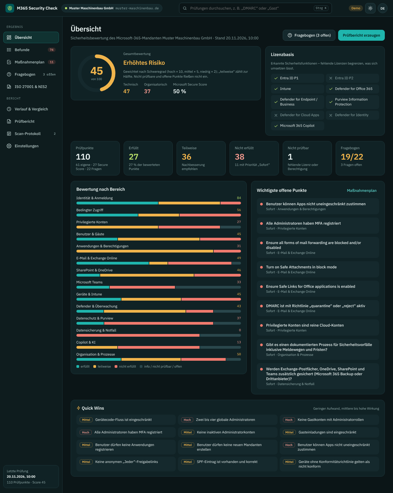
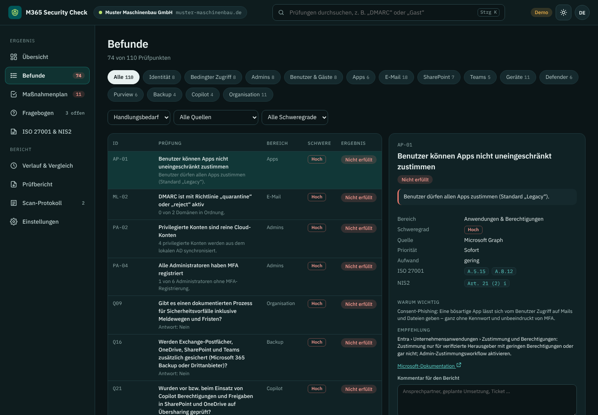
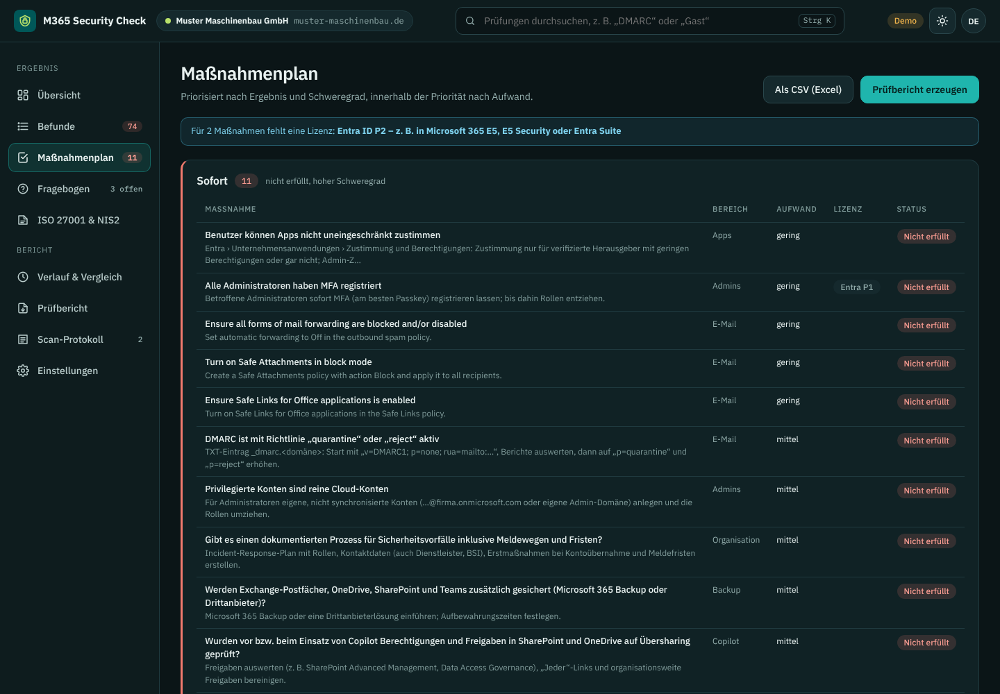
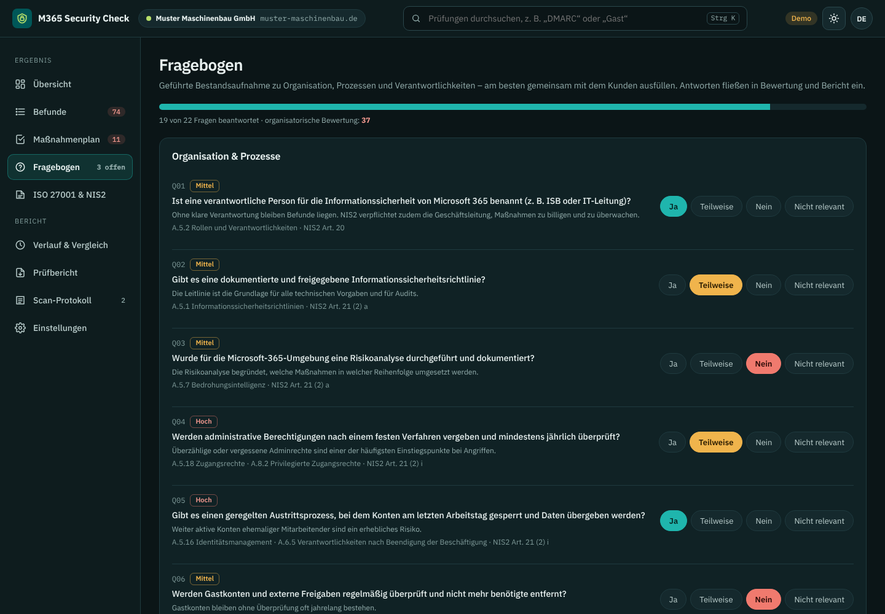
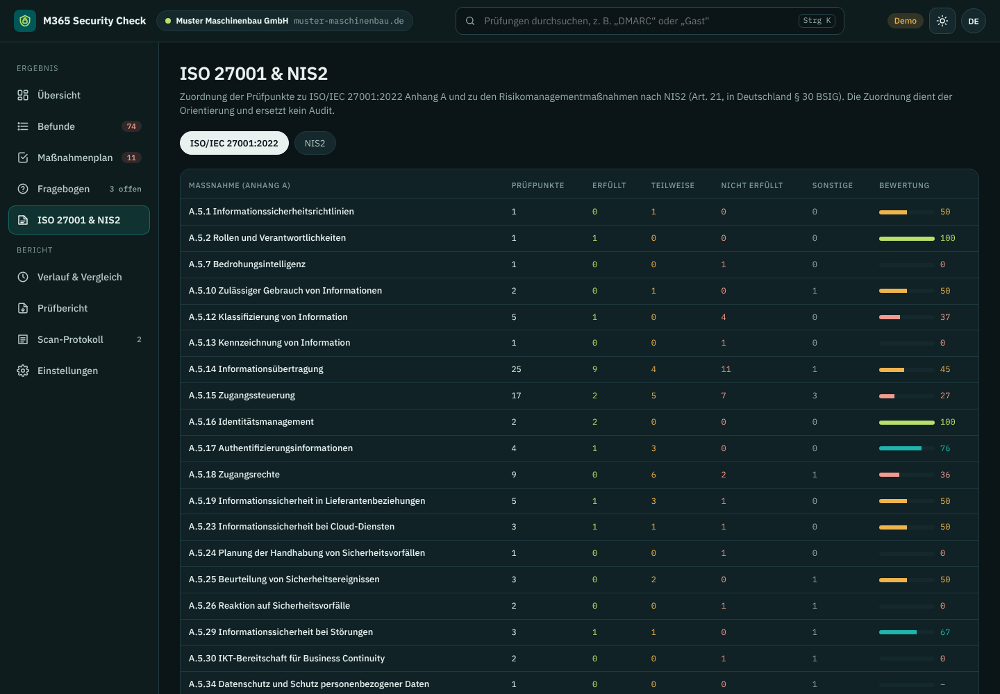
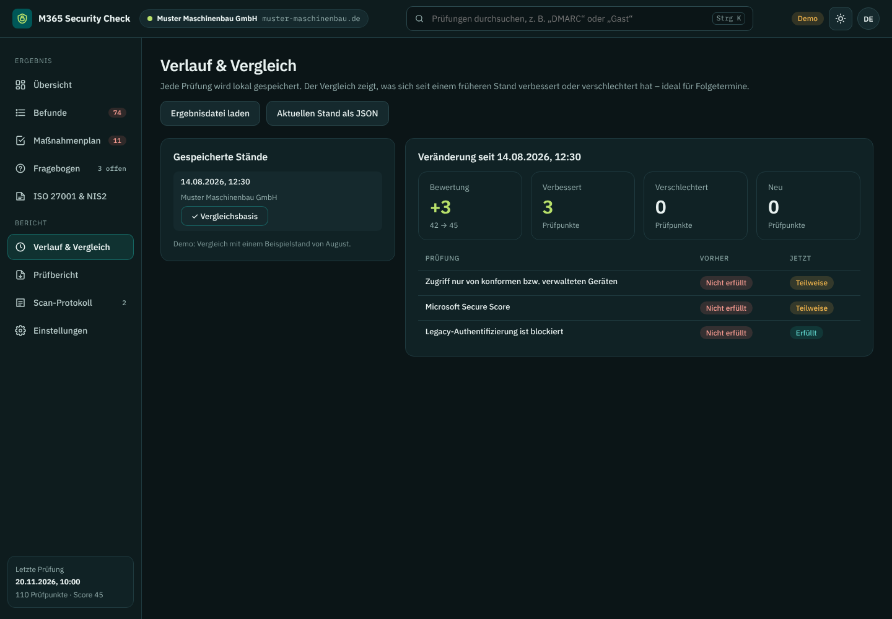
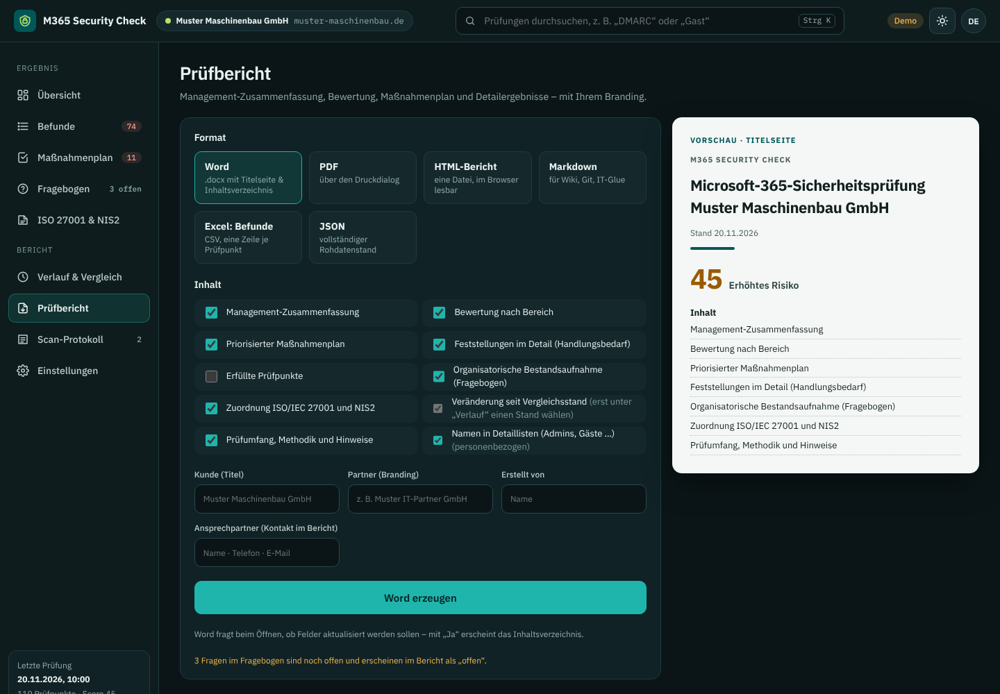

# M365 Security Check

**Kostenloser Sicherheitscheck für Microsoft-365-Mandanten – mit Bewertung, Maßnahmenplan und fertigem Prüfbericht.**

Doppelklick, am Kundenmandanten anmelden, fertig – ohne PowerShell, ohne Installation, nur lesend.

---

## Worum geht es?

Wie sicher ist ein Microsoft-365-Mandant wirklich? M365 Security Check beantwortet das in wenigen Minuten – als Einstieg in ein Sicherheitsgespräch, als Grundlage für ein Angebot oder als regelmäßige Kontrolle:

- prüft **Entra ID, bedingten Zugriff, Administratoren, Gäste, Apps, E-Mail, SharePoint, Teams, Intune, Defender, Purview, Backup und Copilot** – ausschließlich lesend über Microsoft Graph,
- übernimmt die **Kontrollen des Microsoft Secure Score** (Exchange Online, Defender for Office 365, Teams, Purview, Endpoint …) und prüft **SPF, DKIM, DMARC und MTA-STS** im öffentlichen DNS,
- ergänzt die Technik um einen **geführten Fragebogen** zu Organisation, Prozessen, Notfall und KI (22 Fragen),
- ordnet jeden Prüfpunkt **ISO/IEC 27001:2022 (Anhang A)** und **NIS2 (Art. 21, § 30 BSIG)** zu,
- berechnet eine **Gesamtbewertung**, zeigt **Quick Wins** und einen **priorisierten Maßnahmenplan mit Lizenzhinweisen**
- und erzeugt per Klick einen **Prüfbericht** mit Management-Zusammenfassung (Word, PDF, HTML, Markdown, Excel/CSV) – mit Ihrem Partner-Branding.

Technisch ist es – wie der [Intune Inspector](https://github.com/Strychwizzer/intune-inspector) – eine einzelne Programmdatei: Sie startet einen kleinen Webserver, der nur auf `localhost` erreichbar ist, und öffnet die Oberfläche im Browser. Anmeldung und Abfragen laufen direkt vom Browser zu Microsoft Entra ID und Microsoft Graph. Es gibt keinen Cloud-Dienst dazwischen.

## Funktionen im Überblick

| | |
| --- | --- |
| **Technische Prüfung** | 61 eigene Prüfungen: MFA & Sicherheitsstandards, bedingter Zugriff (Legacy-Auth, Admin-MFA, phishing-resistente MFA, Geräte, Gerätecode-Fluss, Notfallkonten, Risiko), globale Admins, Cloud-only-Admins, PIM, inaktive Konten, Gastrechte, App-Zustimmung, App-Berechtigungen & Geheimnisse, SharePoint-Freigabe, Intune-Konformität & Verschlüsselung, Defender-Warnungen, Risikobenutzer, Backup, Copilot – Details im [Prüfkatalog](docs/pruefkatalog.md) |
| **Microsoft Secure Score** | Alle Kontrollen für Exchange, Defender for Office 365, Teams, SharePoint, Purview, Defender for Endpoint/Identity/Cloud Apps als zusätzliche Prüfpunkte (je nach Lizenz 50–100) |
| **E-Mail-DNS** | SPF, DMARC, DKIM, MTA-STS und MX für alle Maildomänen – auch ungenutzte Domänen werden auf Spoofing-Schutz geprüft |
| **Fragebogen** | 22 Fragen zu Verantwortung, Berechtigungen, Offboarding, Vorfällen & Meldepflichten, Schulung, Backup, Notfall, Klassifizierung und KI-Nutzung |
| **Bewertung** | Score 0–100 (technisch, organisatorisch, gesamt), je Bereich, mit Quick Wins, Risikoakzeptanz und Kommentaren |
| **Maßnahmenplan** | Sofort / Kurzfristig / Mittelfristig, mit Aufwand und fehlender Lizenz – auch als Excel-Liste |
| **ISO 27001 & NIS2** | Zuordnung jedes Prüfpunkts, Auswertung je Anhang-A-Maßnahme und NIS2-Anforderung |
| **Verlauf** | Jede Prüfung wird lokal gespeichert; der Vergleich zeigt Verbesserungen für den Folgetermin |
| **Prüfbericht** | Word mit Titelseite, Inhaltsverzeichnis und Seitenzahlen, PDF, HTML, Markdown, CSV, JSON – mit Partner-Branding und Ansprechpartner |
| **Sicher by Design** | nur lesende Graph-Aufrufe, nur `localhost`, strikte Content-Security-Policy, keine Daten an Dritte |

## Screenshots

<table>
<tr>
<td width="50%"> <b>Befunde</b> – Ergebnis, Risiko, Empfehlung, Lizenz und Normbezug je Prüfpunkt</td>
<td width="50%"> <b>Maßnahmenplan</b> – priorisiert, mit Aufwand und Lizenzhinweis</td>
</tr>
<tr>
<td> <b>Fragebogen</b> – organisatorische Bestandsaufnahme im Kundentermin</td>
<td> <b>ISO 27001 & NIS2</b> – Erfüllungsgrad je Anforderung</td>
</tr>
<tr>
<td> <b>Verlauf & Vergleich</b> – Fortschritt seit der letzten Prüfung</td>
<td> <b>Prüfbericht</b> – Format, Inhalt und Branding wählbar</td>
</tr>
</table>

Beispielbericht aus dem Demo-Mandanten: [PDF](docs/beispiel/Beispiel-Pruefbericht.pdf) · [Word](docs/beispiel/Beispiel-Pruefbericht.docx) · [HTML](docs/beispiel/Beispiel-Pruefbericht.html) · [Markdown](docs/beispiel/Beispiel-Pruefbericht.md) · [CSV](docs/beispiel/Beispiel-Befunde.csv)

## Schnellstart

1. Die passende Datei von der [Releases-Seite](../../releases) herunterladen und entpacken.
2. `M365SecurityCheck.exe` doppelklicken (macOS/Linux: siehe [Einrichtung](docs/einrichtung.md#macos-und-linux)).
3. Beim ersten Start die **Client-ID** einer App-Registrierung eintragen (einmalig, siehe unten).
4. Kundenmandanten eingeben, **Mit Microsoft anmelden** – die Prüfung startet automatisch.
5. Fragebogen mit dem Kunden durchgehen, **Prüfbericht** erzeugen.

> Ohne Mandant ausprobieren: Auf der Anmeldeseite **„Demo mit Beispieldaten“** wählen oder `http://localhost:8410/?demo` öffnen.

## Einmalige Einrichtung (Kurzfassung)

1. In Entra ID eine **mehrinstanzenfähige** App-Registrierung anlegen.
2. Plattform **Single-Page-Anwendung** mit der Umleitungs-URI `http://localhost:8410/redirect.html` hinzufügen.
3. Diese **delegierten** Microsoft-Graph-Berechtigungen hinzufügen (alle nur lesend):
   `User.Read`, `Directory.Read.All`, `Policy.Read.All`, `RoleManagement.Read.Directory`, `AuditLog.Read.All`, `IdentityRiskyUser.Read.All`, `SecurityEvents.Read.All`, `SecurityAlert.Read.All`, `SharePointTenantSettings.Read.All`, `DeviceManagementConfiguration.Read.All`, `DeviceManagementManagedDevices.Read.All`, `BackupRestore-Configuration.Read.All`
4. Im Kundenmandanten einmalig die **Administratorzustimmung** erteilen.
5. Anmelden mit der Rolle **Globaler Leser** (auch per GDAP).

Schritt für Schritt: **[docs/einrichtung.md](docs/einrichtung.md)**

## Dokumentation

| Dokument | Inhalt |
| --- | --- |
| [Einrichtung](docs/einrichtung.md) | App-Registrierung, Zustimmung, GDAP, Verteilung, Startoptionen |
| [Prüfkatalog](docs/pruefkatalog.md) | Alle Prüfungen und Fragen mit Schweregrad, Lizenz, ISO- und NIS2-Bezug |
| [Ablauf im Kundentermin](docs/kundentermin.md) | So läuft der kostenlose Check als Vertriebsaktion |
| [Sicherheit & Datenschutz](docs/sicherheit-datenschutz.md) | Architektur, Datenfluss, Ablage, personenbezogene Daten |
| [Fehlerbehebung](docs/fehlerbehebung.md) | Anmeldefehler, fehlende Rechte und Lizenzen |
| [Entwicklung](docs/entwicklung.md) | Aufbau des Codes, Tests, neue Prüfungen, Releases |
| [Änderungen](CHANGELOG.md) | Versionshistorie |

## Systemvoraussetzungen

- Windows 10/11 (x64 oder ARM64), macOS 12+ oder Linux x64
- aktueller Browser (Edge, Chrome, Firefox, Safari)
- Konto mit Leserechten im Zielmandanten, empfohlen **Globaler Leser** (auch per GDAP)

## Status

Version 1.0.0 – Logik, Oberfläche und Berichte sind mit Demo-Daten und gegen eine simulierte Graph-API getestet. Der erste Test an einem echten Mandanten steht noch aus.

## Haftungsausschluss

Die Prüfung ist eine automatisierte Momentaufnahme der Konfiguration. Sie ersetzt keinen Penetrationstest, kein ISMS-Audit und keine Rechtsberatung. Die Zuordnung zu ISO/IEC 27001 und NIS2 dient der Orientierung.

## Lizenz

[MIT](LICENSE) – freie Nutzung, Veränderung und Weitergabe, auch kommerziell; ohne Gewährleistung. Enthaltene Fremdkomponenten: [THIRD_PARTY_NOTICES.md](THIRD_PARTY_NOTICES.md).

Microsoft, Microsoft 365, Entra, Intune, Defender, Purview und Teams sind Marken der Microsoft-Unternehmensgruppe. Dieses Projekt steht in keiner Verbindung zu Microsoft.
