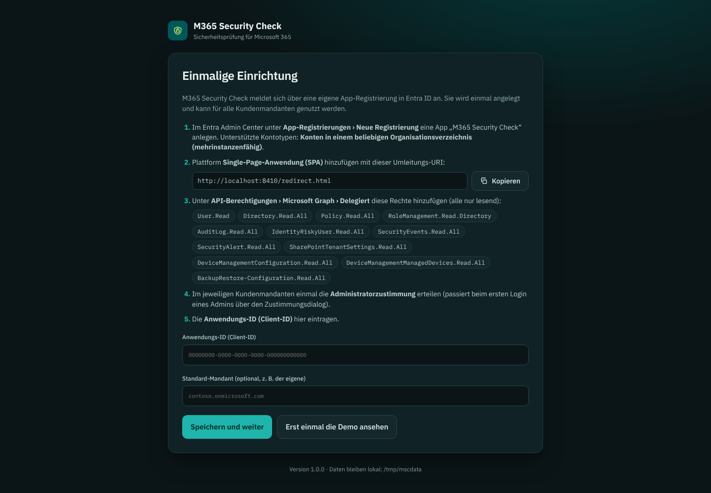
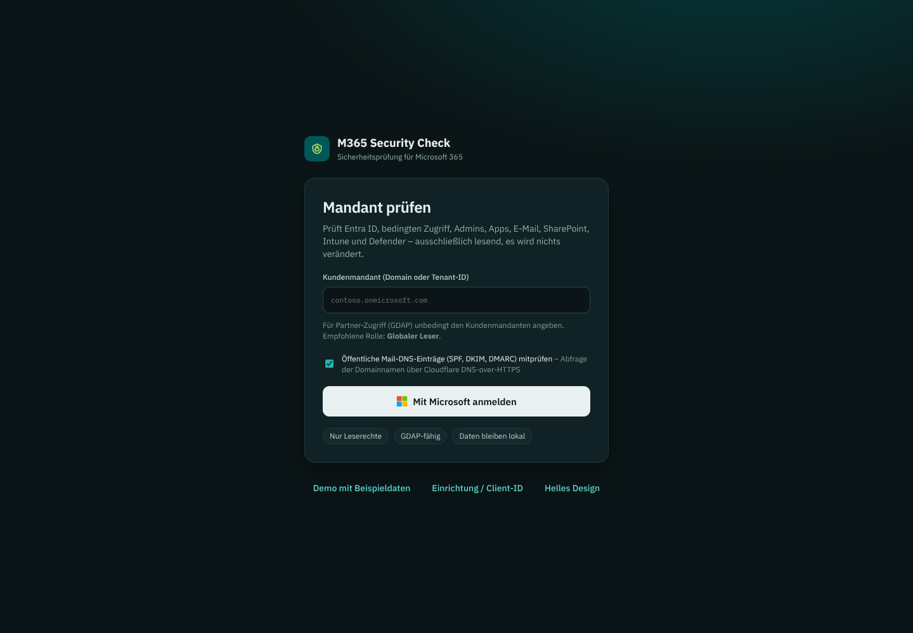

# Einrichtung

M365 Security Check braucht genau eine Sache: eine **App-Registrierung in Microsoft Entra ID**. Sie wird einmal angelegt (z. B. im eigenen Partner-Mandanten) und kann danach für beliebig viele Kundenmandanten genutzt werden.



## 1. App-Registrierung anlegen

1. [Entra Admin Center](https://entra.microsoft.com) öffnen → **Identität → Anwendungen → App-Registrierungen → Neue Registrierung**.
2. Name: `M365 Security Check` (frei wählbar, erscheint im Zustimmungsdialog des Kunden).
3. **Unterstützte Kontotypen:** *Konten in einem beliebigen Organisationsverzeichnis (beliebiger Microsoft Entra ID-Mandant – mehrinstanzenfähig)*. Nur so funktioniert die Anmeldung in Kundenmandanten.
4. Umleitungs-URI jetzt leer lassen → **Registrieren**.

## 2. Plattform „Single-Page-Anwendung“ hinzufügen

1. In der App → **Authentifizierung → Plattform hinzufügen → Single-Page-Anwendung**.
2. Umleitungs-URI: **`http://localhost:8410/redirect.html`**
3. Speichern.

> Wichtig: als **SPA**, nicht als *Web*. Bei „Web“ schlägt die Anmeldung mit `AADSTS9002326` fehl.
> Läuft parallel der Intune Inspector (Port 8400), stört das nicht – M365 Security Check nutzt Port 8410.

Ein Client-Geheimnis oder Zertifikat wird **nicht** benötigt – die App ist ein öffentlicher Client mit PKCE.

## 3. API-Berechtigungen

**API-Berechtigungen → Berechtigung hinzufügen → Microsoft Graph → Delegierte Berechtigungen**:

| Berechtigung | Wofür |
| --- | --- |
| `User.Read` | Anmeldung |
| `Directory.Read.All` | Mandant, Domänen, Lizenzen, Benutzer & Gäste, Gruppeneinstellungen, App-Registrierungen, Unternehmensanwendungen, Zustimmungen |
| `Policy.Read.All` | Sicherheitsstandards, bedingter Zugriff, Authentifizierungsmethoden und -stärken, Autorisierungsrichtlinie, Admin-Zustimmungsworkflow |
| `RoleManagement.Read.Directory` | Rollenzuweisungen, PIM (berechtigte und aktive Zuweisungen) |
| `AuditLog.Read.All` | letzte Anmeldung (inaktive Konten), MFA-Registrierungsstatus |
| `IdentityRiskyUser.Read.All` | Risikobenutzer aus Identity Protection |
| `SecurityEvents.Read.All` | Microsoft Secure Score und dessen Kontrollen (Exchange, Defender, Teams, Purview …) |
| `SecurityAlert.Read.All` | offene Warnungen in Microsoft Defender |
| `SharePointTenantSettings.Read.All` | SharePoint- und OneDrive-Freigabeeinstellungen |
| `DeviceManagementConfiguration.Read.All` | Intune-Konformitätsrichtlinien und Mandanteneinstellungen |
| `DeviceManagementManagedDevices.Read.All` | Gerätezusammenfassung (Konformität, Verschlüsselung, Check-in) |
| `BackupRestore-Configuration.Read.All` | Status von Microsoft 365 Backup (optional) |

Alle Berechtigungen sind **nur lesend**. Das Programm fordert beim Login den Bereich `https://graph.microsoft.com/.default` an, also genau die hier eingetragenen und zugestimmten Rechte. Fehlt eine Berechtigung, läuft die Prüfung trotzdem – die betroffenen Punkte erscheinen als „nicht prüfbar“.

## 4. Client-ID eintragen

Auf der Übersichtsseite der App die **Anwendungs-ID (Client-ID)** kopieren und beim ersten Start eintragen. Sie wird in `M365SecurityCheck-Daten/config.json` gespeichert und lässt sich später unter *Einstellungen* ändern.

## 5. Administratorzustimmung im Kundenmandanten

Die Berechtigungen erfordern eine Administratorzustimmung, einmal pro Kundenmandant:

- **Variante A:** Ein Administrator des Kunden (Globaler Administrator oder Administrator für privilegierte Rollen, für delegierte Rechte auch Cloudanwendungsadministrator) meldet sich an und setzt im Dialog den Haken *Im Namen Ihrer Organisation zustimmen*.
- **Variante B:** Zustimmungslink direkt aufrufen bzw. dem Kunden schicken:
  ```
  https://login.microsoftonline.com/<KUNDENMANDANT>/adminconsent?client_id=<CLIENT-ID>
  ```
  Das Programm zeigt diesen Link bei einem Zustimmungsfehler automatisch an.

Nach der Prüfung kann der Kunde die Unternehmensanwendung „M365 Security Check“ in seinem Mandanten wieder löschen (Entra › Unternehmensanwendungen) – für eine Folgeprüfung wird dann erneut zugestimmt.

## Welche Rolle braucht das Prüfkonto?

**Globaler Leser** reicht für alle Prüfungen. Alternativ in Kombination: Sicherheitsleser (Secure Score, Warnungen, Risikobenutzer), Berichtsleser (MFA-Registrierung), SharePoint-Administrator (Freigabeeinstellungen), Intune-Administrator (Geräte).

## Anmeldung über GDAP (Partner)



- Auf der Anmeldeseite **immer den Kundenmandanten** (Domain oder Tenant-ID) eintragen. Ohne Angabe meldet Entra ID im Heimat-Mandanten des Kontos an.
- Lesen: GDAP-Rolle **Globaler Leser** (ggf. plus **Sicherheitsleser**).
- Zustimmung: GDAP-Rolle **Cloudanwendungsadministrator** – oder der Kunde stimmt selbst zu.
- Was die GDAP-Rolle nicht lesen darf, erscheint im *Scan-Protokoll* als „Keine Berechtigung (403)“.

## DNS-Prüfung

Auf der Anmeldeseite lässt sich die Prüfung der öffentlichen Mail-DNS-Einträge (SPF, DKIM, DMARC, MTA-STS, MX) abwählen. Ist sie aktiv, fragt der Browser die **Domainnamen** der Maildomänen per DNS-over-HTTPS bei Cloudflare (`cloudflare-dns.com`) ab – es werden keine weiteren Mandantendaten übertragen. Ohne DNS-Prüfung erscheinen die E-Mail-DNS-Punkte als „nicht prüfbar“.

## Verteilung an Kollegen

Damit Kollegen die Einrichtungsseite nicht sehen, neben die `M365SecurityCheck.exe` eine `config.json` legen (Vorlage: `config.json.beispiel`):

```json
{
  "clientId": "00000000-0000-0000-0000-000000000000",
  "defaultTenant": "",
  "brandLabel": "Name des Teams"
}
```

Sie wird beim ersten Start in den Datenordner übernommen. `brandLabel` ist der Untertitel unter dem Logo (optional).

## Startoptionen

```
M365SecurityCheck.exe                   Standard: Port 8410, Browser öffnen
M365SecurityCheck.exe -port 8411        anderer Port (Umleitungs-URI ergänzen!)
M365SecurityCheck.exe -no-browser       Browser nicht automatisch öffnen
M365SecurityCheck.exe -data D:\Checks   anderer Datenordner
```

Der Port kann auch dauerhaft in der `config.json` stehen (`"port": 8411`).

## Windows SmartScreen

Die Programmdatei ist nicht signiert. Beim ersten Start meldet Windows ggf. „Der Computer wurde durch Windows geschützt“ → **Weitere Informationen → Trotzdem ausführen**. Alternativ vor dem Entpacken Rechtsklick auf die ZIP → *Eigenschaften* → *Zulassen*. Für eine breite Verteilung empfiehlt sich eine Code-Signatur.

## macOS und Linux

```sh
chmod +x M365SecurityCheck
./M365SecurityCheck
```

macOS blockiert unsignierte Programme beim ersten Start: Rechtsklick → **Öffnen** oder `xattr -d com.apple.quarantine M365SecurityCheck`.

## Beenden

Konsolenfenster schließen oder `Strg+C`. Die Anmeldung gilt nur für die Browser-Sitzung (Session Storage) und wird beim Abmelden bzw. Schließen des Browsers verworfen.
